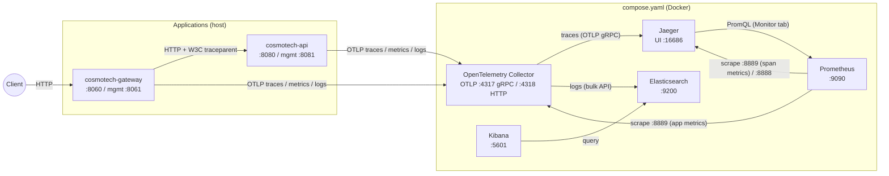
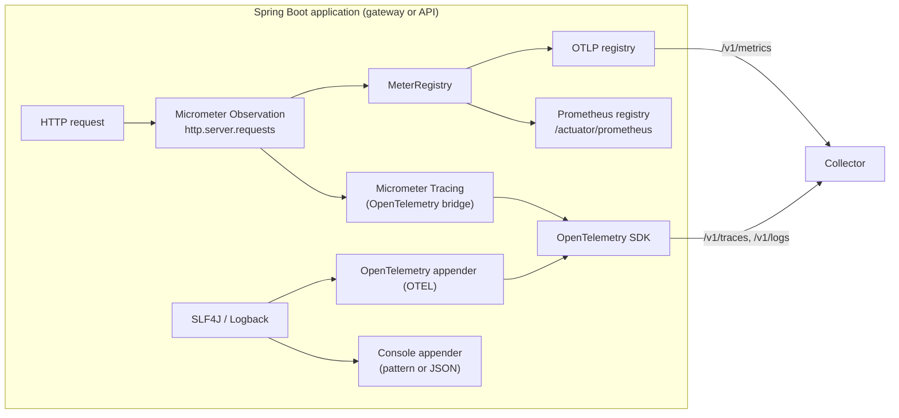

# Observability stack

This page describes the local observability stack started by [`compose.yaml`](../compose.yaml): how telemetry flows
from the Cosmo Tech services to the backends, what each component does, and how to use it. For what the gateway itself
produces (access log format, span attributes, configuration keys), see [telemetry.md](telemetry.md).

The stack is meant for **local development only** (fixed passwords, no TLS, in-memory or non-persistent storage).

## Architecture



Every application sends all its telemetry to a **single endpoint**, the collector, at
`OTEL_EXPORTER_OTLP_ENDPOINT` (default `http://localhost:4318`). The collector decides where each signal goes. The
applications never talk to Jaeger, Prometheus or Elasticsearch directly, so backends can be swapped by changing the
collector configuration only.

### Inside the applications



One HTTP request produces a single observation. Micrometer turns it into a span (tracing) and into timers (metrics).
Logs written during the request carry the current `traceId`/`spanId`.

## Flows

### 1. Traces

| Step | Description |
| --- | --- |
| Production | Each incoming request opens a server span (`http.server.requests`). Outgoing HTTP calls open client spans. Attributes: route, user, query, client address, user agent (see [telemetry.md](telemetry.md#traces-and-metrics)). |
| Propagation | The gateway forwards the trace context to downstream services in the W3C `traceparent` header. `cosmotech-api` continues the same trace, so one user request appears as a single trace across both services. |
| Sampling | `OTEL_TRACES_SAMPLER_ARG` (default `1.0`, everything). |
| Export | OTLP/HTTP to `<endpoint>/v1/traces`, batched by the SDK. |
| Collector | `traces` pipeline: `otlp` receiver, `batch` processor, `otlp/jaeger` exporter (`jaeger:4317`). |
| Storage | Jaeger, in memory (up to 100,000 traces, lost on restart). |
| Usage | Jaeger UI: search by service, operation, tags (`enduser.id=...`, `http.status_code=500`), duration. Shows the timeline across gateway and API. |

### 2. Span metrics (RED metrics derived from traces)

| Step | Description |
| --- | --- |
| Production | Jaeger's `spanmetrics` connector computes **R**ate, **E**rrors and **D**uration for each service and operation from incoming spans. |
| Export | Exposed on `jaeger:8889` (Prometheus format), flushed every `SPANMETRICS_FLUSH_INTERVAL` (15 s). |
| Storage | Prometheus scrapes them (`aggregated-trace-metrics` job). |
| Usage | Jaeger UI **Monitor** tab: per-service and per-operation latency percentiles, request rate and error rate, with links to the matching traces. |

These metrics only depend on traces. They work even when `OTEL_EXPORT_ENABLED` is `false`, as long as traces are exported.

### 3. Application metrics

| Step | Description |
| --- | --- |
| Production | Micrometer meters: HTTP server/client timers (histograms and SLO buckets), JVM (memory, GC, threads), process, connection pools, etc. Common tags: `application.instance`, `deployment.environment.name`. |
| Export (push) | OTLP registry, to `<endpoint>/v1/metrics` every 30 s. Only when `OTEL_EXPORT_ENABLED=true`. |
| Collector | `metrics` pipeline: `otlp` receiver, `batch` processor, `prometheus` exporter on `:8889`. Resource attributes (`service.name`, ...) become labels (`resource_to_telemetry_conversion`). |
| Storage | Prometheus scrapes `otel-collector:8889` (`otel-collector` job). |
| Usage | Prometheus UI (PromQL), alerting rules, Grafana dashboards. Names are converted to Prometheus conventions (`http.server.requests` becomes `http_server_requests_*`, `service.name` becomes `service_name`). |

The services also keep the **pull** endpoint `/actuator/prometheus` on their management port. It is not scraped by the
local Prometheus, but can be scraped directly, which is the usual setup in Kubernetes.

### 4. Logs

| Step | Description |
| --- | --- |
| Production | Every SLF4J log record (application logs, access log lines `gateway_access` / `api_access`). |
| Console | Always written to the console: pattern with `[application,traceId,spanId]` in `dev`, JSON (`logstash`) in other profiles. |
| Export | The `OTEL` Logback appender sends the records to the OpenTelemetry SDK, which exports them to `<endpoint>/v1/logs`. Only when `OTEL_EXPORT_ENABLED=true`. Each record carries `trace_id`, `span_id`, the logger, the thread, the code location and **all MDC entries** as attributes. |
| Collector | `logs` pipeline: `otlp` receiver, `batch` processor, `elasticsearch` exporter in `otel` mapping mode. |
| Storage | Elasticsearch data stream `logs-generic.otel-default` (no Docker volume: lost on `docker compose down`). |
| Usage | Kibana **Discover**: full-text search, filters on any attribute, histograms, saved searches, dashboards. |

### 5. Correlation between signals

The three signals share the same identifiers, which lets you move from one to another:

| From | To | How |
| --- | --- | --- |
| Log (Kibana) | Trace (Jaeger) | Copy `trace_id` and open `http://localhost:16686/trace/<trace_id>`. |
| Trace (Jaeger) | Logs (Kibana) | Copy the trace id and search `trace_id : "<trace_id>"` in Discover. |
| Metric (Prometheus / Jaeger Monitor) | Traces | Filter traces in Jaeger by the same service, operation and time window. |
| Any signal | Instance | `application.instance` (metrics), `service.name` + `deployment.environment.name` (all signals). |

### What is exported, and when

| Signal | Default | `dev` profile | `OTEL_EXPORT_ENABLED=true` |
| --- | --- | --- | --- |
| Traces | no | **yes** | yes |
| Span metrics (Jaeger) | no | **yes** (derived from traces) | yes |
| Application metrics (OTLP) | no | no | **yes** |
| Logs (OTLP) | no | no | **yes** |
| `/actuator/prometheus` | always | always | always |
| Console logs | always | always | always |

## Components

### OpenTelemetry Collector

`otel/opentelemetry-collector-contrib` — configuration: [`docker/otel-collector/config.yaml`](../docker/otel-collector/config.yaml)

**Role.** Single OTLP entry point for all services. Receives, processes and routes each signal to its backend.

**Main use here.** Receives traces, metrics and logs from the gateway and the API, batches them, and forwards them to
Jaeger, Prometheus and Elasticsearch.

**Possible features.**

- Swapping or adding backends without touching the applications (e.g. Tempo, Loki, a SaaS vendor, several exporters in
  parallel).
- Enrichment and filtering: `resource`, `attributes`, `transform` (OTTL) and `filter` processors, for example to add
  the cluster name or to drop health-check spans.
- Masking sensitive data (tokens, emails) before storage, with the `attributes` or `redaction` processors.
- Tail-based sampling (`tail_sampling` processor): keep every trace with an error or high latency, and only a fraction of
  the others.
- Memory protection with the `memory_limiter` processor, retries and persistent queues.
- Other inputs: scraping Prometheus endpoints, reading log files, host or Kubernetes metrics.

**Spring Boot integration.** The `otel/opentelemetry-collector-contrib` image is recognised by Spring Boot's Docker
Compose support. The gateway gets the traces, metrics and logs endpoints automatically. Other services use the fixed
ports `4317`/`4318`.

### Jaeger

`jaegertracing/jaeger` (v2) — configuration: [`docker/jaeger/config-spm.yaml`](../docker/jaeger/config-spm.yaml)

**Role.** Trace storage and UI.

**Main use here.** Inspect the full path of a request across the gateway and the API: span timeline, attributes,
errors, latencies.

**Possible features.**

- Search by service, operation, tags, duration and time range.
- Trace timeline and span details, comparison of two traces, critical path.
- Service dependency graph (**System Architecture** tab).
- Service Performance Monitoring (**Monitor** tab), built from the span metrics stored in Prometheus.
- Persistent storage in production (Elasticsearch, OpenSearch, Cassandra, ...), instead of the in-memory backend used
  here.

### Prometheus

`prom/prometheus` — configuration: [`docker/jaeger/prometheus.yml`](../docker/jaeger/prometheus.yml)

**Role.** Time-series database for metrics, with a pull (scrape) model.

**Main use here.** Stores the application metrics exposed by the collector, the span metrics produced by Jaeger, and
Jaeger's own metrics. Serves as the metrics backend of the Jaeger **Monitor** tab.

| Job | Target | Content |
| --- | --- | --- |
| `otel-collector` | `otel-collector:8889` | Gateway and API metrics (HTTP, JVM, ...) |
| `aggregated-trace-metrics` | `spm_metrics_source:8889` | RED metrics derived from spans |
| `jaeger-collector-metrics` | `spm_metrics_source:8888` | Jaeger internal metrics |

**Possible features.**

- PromQL queries and graphs in the UI (`/graph`), target health (`/targets`).
- Recording rules and alerting rules (with Alertmanager): error rate, latency SLO, instance down.
- Data source for Grafana dashboards.
- Direct scraping of `/actuator/prometheus` (pull model), as an alternative to OTLP push.

Example queries (check the exact names with the UI autocompletion):

```promql
# Request rate per service and route
sum by (service_name, uri) (rate(http_server_requests_milliseconds_count[1m]))

# Error rate per service
sum by (service_name) (rate(http_server_requests_milliseconds_count{status=~"5.."}[5m]))
  / sum by (service_name) (rate(http_server_requests_milliseconds_count[5m]))
```

### Elasticsearch

`docker.elastic.co/elasticsearch/elasticsearch` — single node, security enabled over plain HTTP, 512 MB heap.

**Role.** Log storage and search engine.

**Security.** Security must stay enabled: Kibana's Observability and onboarding pages call the security APIs and fail
with *Unable to load content* without them. Local credentials:

| User | Password | Used by |
| --- | --- | --- |
| `elastic` (superuser) | `ELASTIC_PASSWORD` (default `changeme`) | Collector (`basicauth/elasticsearch` extension), Kibana login, `curl` |
| `kibana_system` | `KIBANA_PASSWORD` (default `changeme`) | Kibana server. Set by the one-shot `elasticsearch-setup` service. |

Kibana also needs encryption keys (`XPACK_ENCRYPTEDSAVEDOBJECTS_ENCRYPTIONKEY`, ...) for alerting, Fleet and
onboarding. `compose.yaml` sets fixed local values.

**Main use here.** Stores the logs of all services in the `logs-generic.otel-default` data stream, using the
OpenTelemetry field layout:

| Field | Content |
| --- | --- |
| `@timestamp` | Log timestamp |
| `body.text` | Log message |
| `severity_text` | Log level (`INFO`, `WARN`, ...) |
| `trace_id`, `span_id` | Trace context |
| `resource.attributes.service.name` | `cosmotech-gateway`, `cosmotech-api` (from `spring.application.name`). Use it to filter by application. |
| `resource.attributes.deployment.environment.name` | Environment |
| `attributes.*` | Logger, thread, code location, and MDC entries (`method`, `path`, `user`, `status`, `durationMs`, ...) |

**Possible features.**

- Full-text search and aggregations (top users, slowest paths, error counts per route).
- Index lifecycle management (retention, rollover).
- Storing traces as well (the collector can send traces to Elasticsearch, and Jaeger can use it as a backend).
- Elastic APM / Observability UIs, which understand OpenTelemetry data natively.

The REST API is reachable at `http://localhost:9200`, for example:

```bash
curl -u elastic:changeme 'http://localhost:9200/logs-*/_search?q=api_access&size=5&pretty'
```

### Kibana

`docker.elastic.co/kibana/kibana` — <http://localhost:5601> (login `elastic` / `changeme`)

**Role.** UI for Elasticsearch.

**Main use here.** Browse and search the logs. On first use, create a data view in **Discover** with the index
pattern `logs-*` and the timestamp field `@timestamp`. The logs also appear in **Observability > Discover**.

The **Add data > OpenTelemetry** onboarding page explains how to install Elastic's own collector (EDOT). It is not
needed here: the collector of this stack already writes to Elasticsearch.

Example KQL queries:

```text
resource.attributes.service.name : "cosmotech-api" and severity_text : "ERROR"
body.text : "api_access" and attributes.status >= 500
trace_id : "4bf92f3577b34da6a3ce929d0e0e4736"
attributes.user : "jdoe@cosmotech.com"
```

**Possible features.**

- Saved searches, visualisations and dashboards (Lens), for example access-log dashboards per route or per user.
- Alerting rules on log patterns.
- **Observability > Logs** and APM views, which rely on the OpenTelemetry fields.
- Dev Tools console to query Elasticsearch directly.

## Ports

| Port | Component | Use |
| --- | --- | --- |
| `4317` | Collector | OTLP gRPC |
| `4318` | Collector | OTLP HTTP (used by the gateway and the API) |
| `16686` | Jaeger | UI |
| `9090` | Prometheus | UI and HTTP API |
| `9200` | Elasticsearch | REST API |
| `5601` | Kibana | UI |
| `8061` / `8081` | Gateway / API | Actuator (`/actuator/prometheus`, `/actuator/health`, ...) |

Ports `8888`/`8889` (collector and Jaeger metrics) are only reachable inside the Docker network.

## Getting started

1. Start the gateway with export enabled. `bootRun` starts the whole stack:

   ```bash
   OTEL_EXPORT_ENABLED=true ./gradlew bootRun
   ```

2. Start `cosmotech-api` with `OTEL_EXPORT_ENABLED=true` (and the `dev` profile). Its default endpoint
   `http://localhost:4318` already points to the collector.
3. Send a few requests through the gateway, then check:
   - Jaeger: one trace per request, with gateway and API spans.
   - Prometheus **Status > Targets**: the three jobs are `UP`.
   - Kibana **Discover** (data view `logs-*`): the logs of both services.
4. Stop the stack with `docker compose down`. All stored data (traces, metrics, logs) is lost.

To start the stack without the gateway: `docker compose up -d`.

## Limitations

- Local development only: fixed passwords and encryption keys, no TLS, and no service uses a persistent volume.
- When `OTEL_EXPORT_ENABLED` is not set, only traces (and the span metrics derived from them) are exported.
- Elasticsearch needs about 1 GB of memory. On Linux, it may require `vm.max_map_count` of at least `262144`.
- Prometheus does not reload its configuration automatically: run `docker compose restart prometheus` after editing
  `prometheus.yml`.
